# Solo

English | [简体中文](README.zh-CN.md)

**Agents write the code. You read it, judge it and direct them.**

Solo is an editor for AI coding agents, built on [Zed](https://github.com/zed-industries/zed). The terminal fills the window, and agents like Claude Code and Codex run in a real terminal, with the command-line tools and subscriptions you already have. When you need to look at code, a full code editor opens on the right, so you can see what the agent changed at any time.

**Download:** [Windows x64 installer](https://github.com/lucas9801/solo/releases/latest/download/Solo-Setup.exe) ([all releases](https://github.com/lucas9801/solo/releases)). The installer is unsigned: when SmartScreen warns, click "More info", then "Run anyway". You can also install from the [Microsoft Store](https://get.microsoft.com/installer/download/9NBW452JVWN6) ([Store page](https://apps.microsoft.com/detail/9NBW452JVWN6)): signed by Microsoft, updated through the Store, and possibly a version behind GitHub.

[User guide](docs/guide/en.md) · [Compared with other tools](docs/site/en/compare/index.md)

https://github.com/user-attachments/assets/85627f07-1bb5-4f68-8199-c3afbdc9fa3b

## Features

The ones used most come first; the [full feature list](#all-features) follows.

### Terminal and editor side by side

The terminal fills the whole window. Open a file and the editor appears on the right; close the last file and it goes away again. The divider can be dragged, and the split is remembered. A row of buttons on the left opens the sidebars: files, git, outline, the agent board and more.

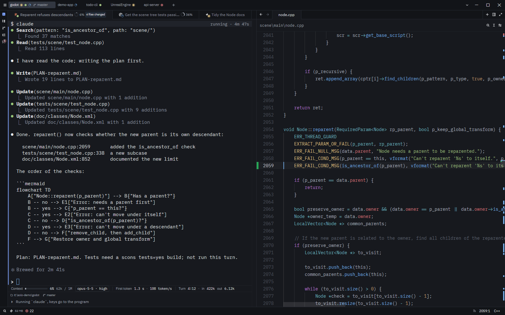

### Agent status at a glance

The tab of a terminal running an agent shows the agent's icon, its session name and a traffic-light status: blue working, yellow waiting for you, green done with a turn for you to look at, red failed; then how much of the context is used. Hover it for the model and reasoning effort, the context, the directory and branch, the tokens and time of the turn and the session, the time to the first token and the output speed. With Solo in the background, an agent that needs your input sends a desktop notification.

Claude Code, Codex and Copilot CLI report their status through hooks Solo adds for the session, and OpenCode through a plugin Solo adds, without changing their config; other agents are recognized from their screen with per-agent rules.

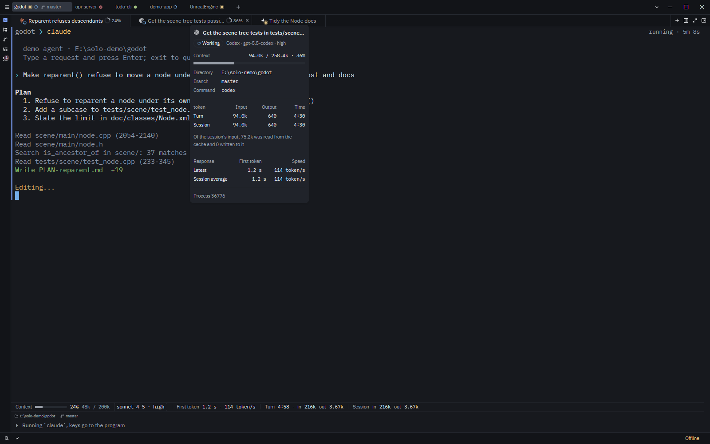

When a status looks wrong, right-click in the terminal and choose "Why This Agent Status?": Solo tells you whether it came from a hook report, the program exiting or a screen rule, and when the last report and output arrived.

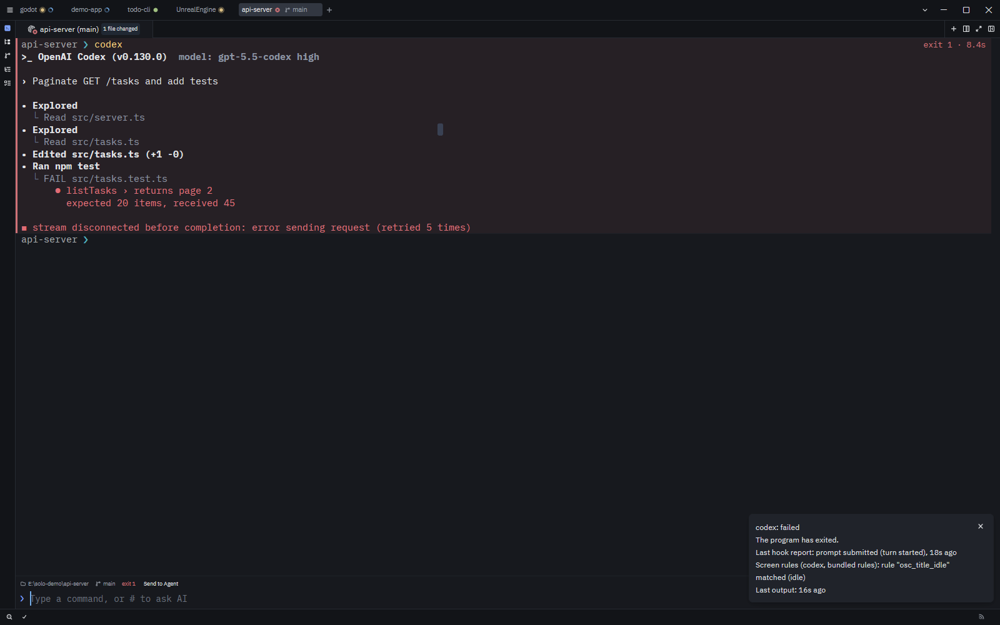

### Workspace tabs: one per project

Each project folder is a workspace with a tab in the title bar, holding its own terminals, agents, editors and file tree; switching tabs swaps all of them. A tab shows the status of the project's agents, so you see an agent waiting in a background project too; its menu lists its terminals, and a click jumps to one. `Ctrl+Alt+1…9` switches, and all the tabs come back after a restart.

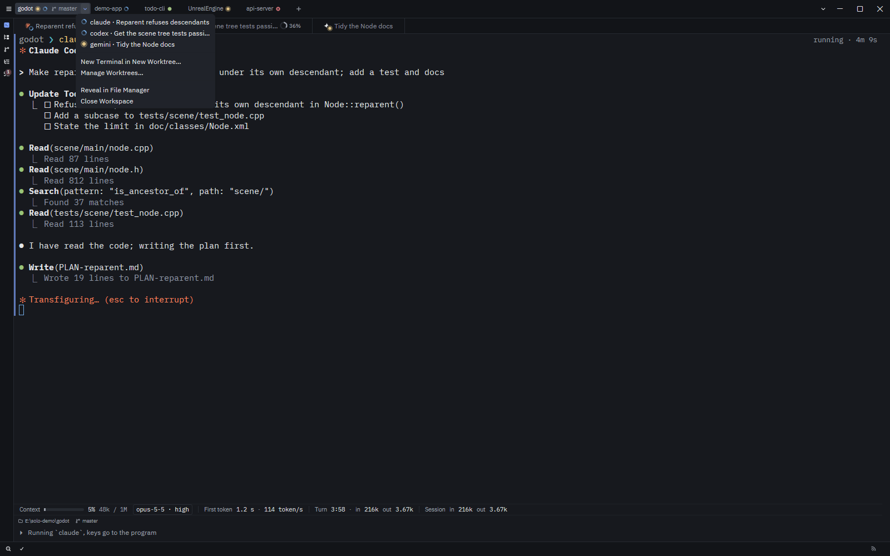

### Per-turn review and roll back

When an agent finishes a turn, its terminal tab shows "N files changed". Open it to see everything the turn changed: keep or reject each hunk, comment on lines and send all the comments to the agent at once. Solo also tells you how many errors and warnings the turn **added**, and how many it fixed. You can roll back to before any turn, and undo the rollback; snapshots are kept in Solo's own folder, never touching your branch, index or stash. [More →](docs/site/en/features/review.md)

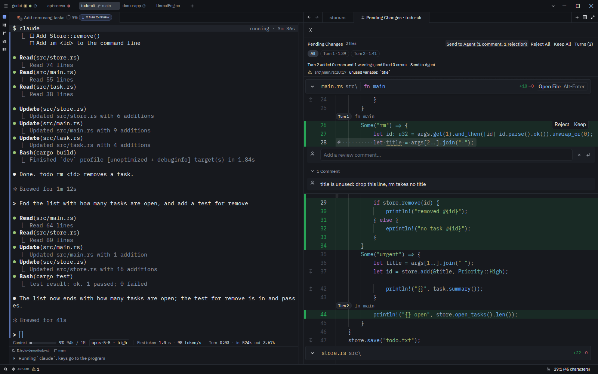

### Agent timeline

Claude Code and Codex sessions are listed turn by turn: each prompt, the files read and changed, the commands run and the answer, with files opening on a click. Right-click a terminal tab and choose "Agent Timeline".

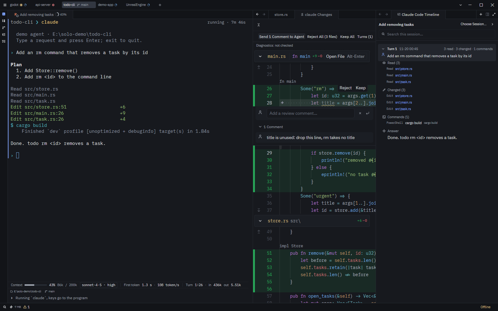

### Updates and crashes don't stop your agents

Each terminal's shell runs in a small background process. When Solo restarts for an update, or even crashes, the agents and builds that are running keep going; when Solo opens again it connects to them, with the screen, the output printed meanwhile and the agent's status. Quitting Solo yourself asks first when agents are running, as closing a window does, and then ends them (`terminal.keep_running_on_quit` keeps them running instead). Idle shells end with Solo. A terminal whose agent couldn't be kept offers to continue its session after a restart.

### Click links in the terminal

A file path in the terminal's output opens with a click: code in the editor, Markdown in a rendered preview (Mermaid diagrams and images included), images in the image viewer. When the agent says "changed src/app.ts:42", a click takes you to that line; when the output only has a line number (such as `(:120)`), Solo finds the file mentioned earlier that has that line and opens it.

Links Solo shouldn't just open show a small menu instead: a web address outside this computer (open in the browser or in Solo, copy it), a file Solo can't open such as an `.apk` or `.dll` (open it with its program, show it in File Explorer, copy the path), a file name several files have when it isn't clear which one is meant (pick one), and a file only another project tab has (switch to that tab). `Ctrl`+click does the menu's first option, except that a file Solo can't open is only shown in File Explorer, never handed to a program; for programs and shortcuts (`.exe`, `.lnk`, ...) running it is the menu's last option. The `terminal.link_menu` setting (Settings › Terminal › "Menu When Clicking Links") turns the menu on for every link (`always`) or off (`never`).

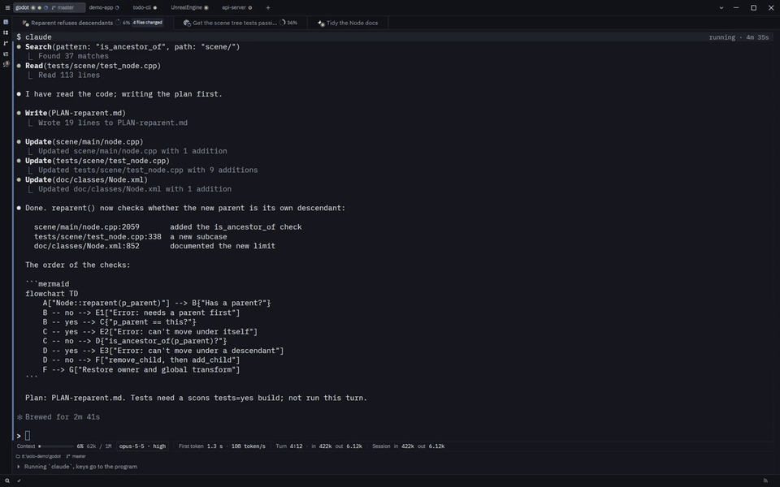

### Mermaid diagrams and document review

Click the `mermaid` line of a `mermaid` block in an agent's output to see the diagram; when the screen only shows part of it, Solo takes the whole block from the agent's transcript. Mermaid diagrams in Markdown previews render too.

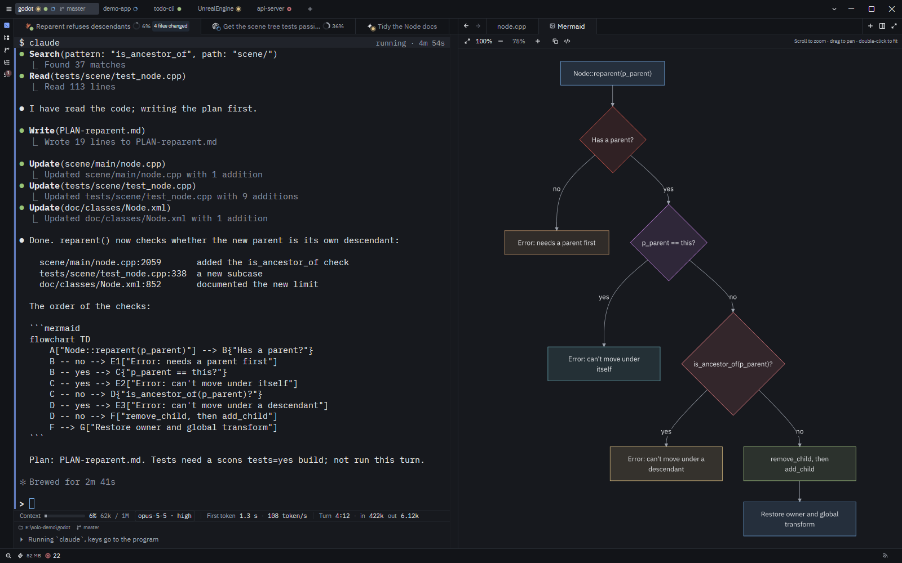

Plans and designs the agent writes open in a preview: select text, comment, and send the comments to the agent at once; when the document changes again, Solo tells you which parts. [More →](docs/site/en/features/documents.md)

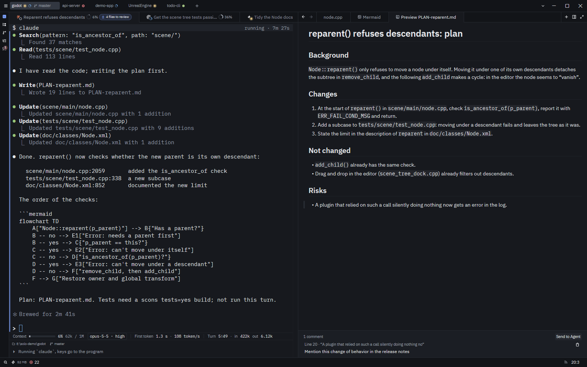

### Several agents at once

Each task gets its own git worktree and branch, so agents don't get in each other's way; merge it, open a pull request or discard it when done. In a workspace with several repositories, a task can span them. The agent board on the left lists every agent and task, with those waiting for you first. An agent in a terminal can also use `solo-cli agent` to look at and wait for the other agents, send them messages, or start a new task. [More →](docs/site/en/features/parallel.md)

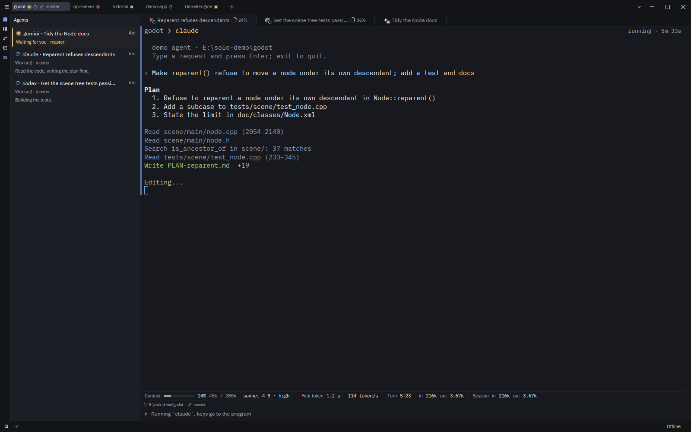

### Built-in browser

Links to local addresses (localhost and the like) open in Solo, so you don't switch windows while developing. Pick elements on a page, comment on them, and send the comments to an agent at once, with their selectors, HTML, styles and screenshots. With a setting on, agents started in Solo's terminals can also open pages, click, fill in forms and take screenshots in this browser while you watch. [More →](docs/site/en/features/browser.md)

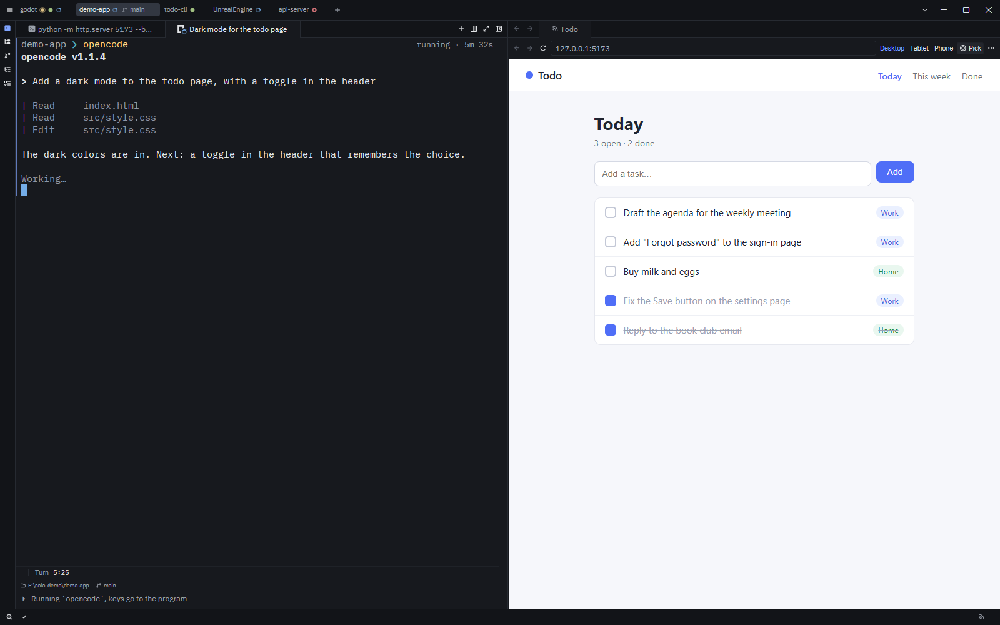

### A good terminal

Command blocks, an input editor at the bottom, completions as you type, a failed command's errors sent to an agent in one click, and a command from a sentence by your own Claude Code or Codex. [More →](docs/site/en/features/terminal.md)

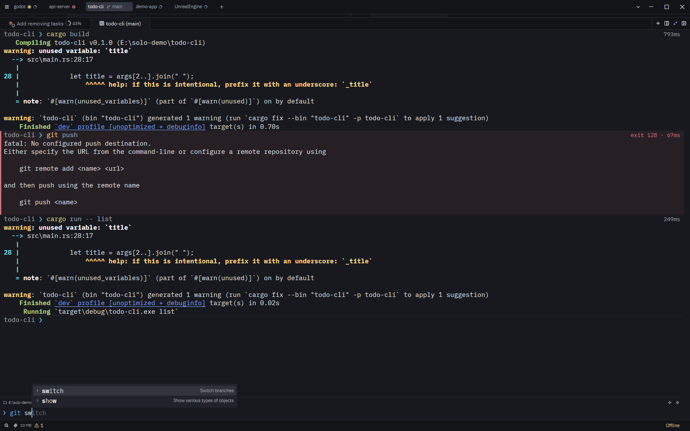

### Asks before downloading, works offline

Before a language server, Node.js and the like is first downloaded, Solo asks once and says where it comes from; you can allow all and remember, choose one by one, or point to a local copy. The button at the right of the status bar switches to offline mode, where Solo only connects to this computer and the local network.

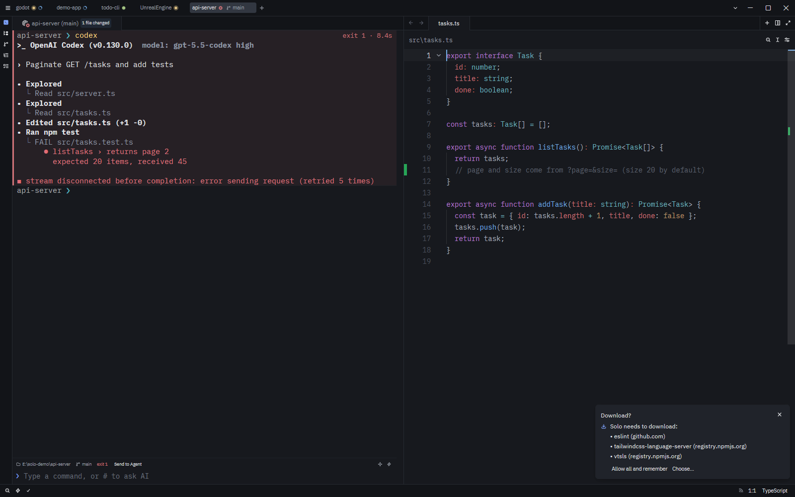

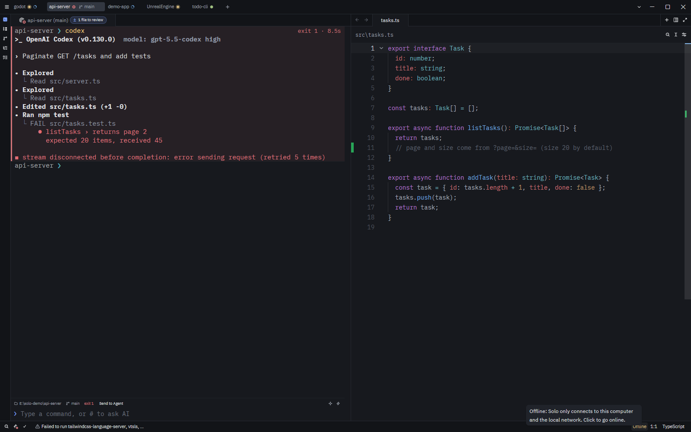

### Updates inside Solo

A newer version shows an update button at the right of the title bar, with no notification; its menu sums up the release and offers "Update and Restart", "Install When Solo Quits", the release notes or skipping the version.

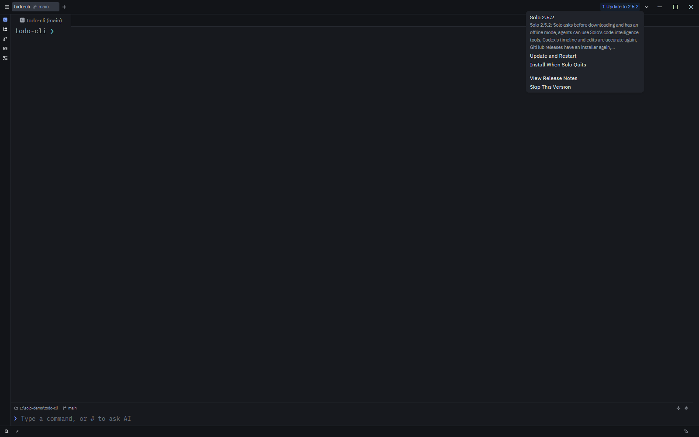

### All features

**Terminal**

- **Command blocks**: each command and its output form a block, with the exit code and duration, failed ones in red, a timer while running, and the command pinned to the top while scrolling through long output. Select a block to copy the command or the output, run it again, or send it to an agent in another terminal with `Alt+Enter`.
- **Send failures to an agent**: when a command fails, click "Send to Agent". Solo picks out only the compiler errors, failed tests and assertions (cargo, tsc, gcc/clang, MSVC, pytest, go, jest), or else the end of the output, and pastes it into the agent working in the same directory.
- **Input editor**: commands are typed in a real editor at the bottom, with multiple cursors, undo, `Shift+Enter` for new lines and syntax highlighting.
- **Completions as you type**: subcommands, options and argument values (git branches, npm scripts, docker containers, ...) for about 500 common commands, plus PowerShell's own completions; grey suggestions from history and command specs, and fuzzy history search on `Ctrl+R`.
- **`# what you want`**: describe it in a sentence, and your own Claude Code or Codex (with their tools turned off) suggests a command, which runs only once you confirm it; the command that just failed and its output can go along.
- **Workflows**: save commands you use often with `{{arguments}}`, bring them up with `Ctrl+Shift+R`, or run one in a new terminal from the + menu.
- **Shells**: PowerShell, bash, zsh, fish. After a restart, terminals reopen in their directories and with their titles. Like Windows Terminal, a new terminal takes `PATH` and the other environment variables from the system's current settings, so a program installed while Solo was open (or one Solo's launcher didn't pass on) is found without restarting Solo.
- The terminal column can be hidden while its agents keep running; meanwhile the terminal icon on the left shows how many agents want a look.

**Agents and status**

- More than twenty agents are recognized with no setup; other programs can be added with `agent_commands`, or report their own status through the [status protocol](docs/agent-status-protocol.md).
- Terminal tabs: the agent's icon, its session name, a traffic-light status, and a context ring with its percentage; the hover card and the usage bar at the bottom of the terminal show the model, reasoning effort, tokens, turn time, time to first token and output speed.
- Desktop notifications (with Solo in the background): when an agent needs your input, when a program asks for one, when a long command finishes, and (off by default) when an agent stops; each has its own switch.
- **Agent board**: a sidebar listing every agent terminal and agent task, with its status, branch, last turn's changes, running time and last message; click one to go to its terminal.
- **Timeline** (Claude Code, Codex): each turn's prompt, the files read and changed, the commands run and the answer.
- **Sending things to an agent**: in the editor, `Ctrl+Alt+K` sends the selection or the cursor position, and `Ctrl+Alt+Shift+M` sends the file's diagnostics.
- **IDE tools for agents**: Claude Code and Codex in Solo's terminals can use the language servers Solo already runs: find symbols, go to definition, find references, see diagnostics; read-only, and only in that workspace (`terminal.ide_tools` turns them off).
- **Why this status?**: right-click a terminal tab and choose "Why This Agent Status?" to see whether the status came from a hook or from the screen, and when the last report arrived; agents can ask with `solo-cli agent why`.
- Closing a terminal or a window while an agent runs asks first.

**Workspaces**

- One workspace tab per project folder, each with its own terminals, agents, editors and file tree; the tab shows its agents' status, and its menu lists its terminals.
- When a terminal `cd`s into another project, its tab gets a mark and a bar on top offers to move it to that project's tab (without interrupting what runs in it); you can also "Move to" a tab at any time.
- A workspace holding unrelated projects can be split into several tabs.
- "Open with Solo" on a file or folder in Explorer puts it in the open window, in the matching tab.

**Review and roll back**

- Each turn's changes: keep or reject each hunk, or keep or reject all; rejecting a file the turn created moves it to the recycle bin.
- Comment on lines and send the comments to the agent at once.
- How many errors and warnings the turn added and fixed; click one to go there.
- Go to definition, find references and search work in the review, and a line above each hunk names the function it's in.
- Roll back to before any turn, and undo the rollback; a rollback that fails partway keeps the undo point.
- When the agent reports the files it edits (Claude Code does, and Solo reads Codex's from the telemetry Codex sends it), a turn is only those files: what you or another agent changed meanwhile is listed separately, and "Reject All" leaves it alone.
- When the folder isn't a git repository or has too many files to snapshot, the turn still lists the files it changed.
- Untracked files over 50 MB aren't snapshotted: the review says so, and a rollback leaves them alone. Old snapshots are cleaned up automatically, 4 GB at most in all.

**Editor**

- Zed's editor: language servers, go to definition, find references, project-wide search, multiple cursors, the git panel, diffs and blame.
- Language servers use fewer resources on large repositories by default; the status bar shows how much memory they take, and each project can choose full analysis, open files only, or off. Solo warns when they take a lot of memory, and says why when one fails to start.

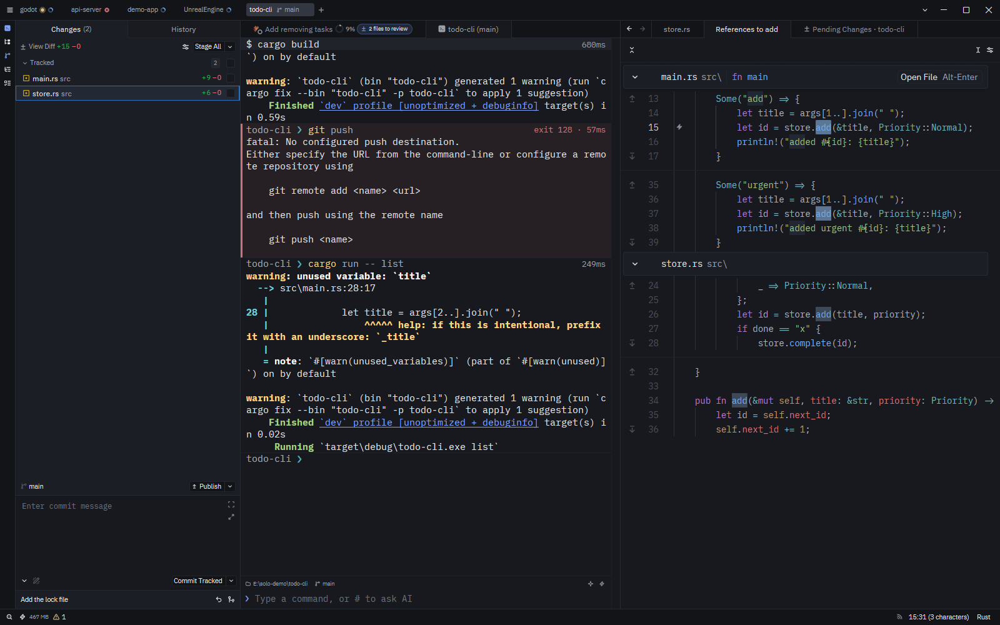

**Documents, Markdown and diagrams**

- Paths in the terminal's output open with a click: code, Markdown previews, the image viewer; links with only a line number find the right file too.
- `mermaid` blocks in an agent's output open as diagrams, and Mermaid diagrams and images in Markdown previews are shown.
- Comment in a Markdown preview and send the comments to an agent at once; when the document changes later, Solo says how much changed, and "Show Changes" marks the changed blocks.
- A file Solo can't open (an .apk, say) shows its full path, with "Reveal in File Explorer" and opening it with the default app.

**Built-in browser**

- Web links in the terminal, Markdown previews and the timeline: local addresses open in Solo by default and the rest in the system browser (`browser.open_links` changes it); `Ctrl+Shift`+click opens a link the other way.
- Toolbar: back and forward, the address bar, desktop/tablet/phone viewports, developer tools, find in page.
- **Pick**: click page elements to comment on them, numbered on the page; "Send to Agent" pastes them into the agent's prompt (without sending it).
- **Letting agents use the browser** (`browser.allow_agent_control`, off by default): Claude Code and Codex get Playwright MCP (Node.js needed) to open pages, read them, click and take screenshots in Solo's browser.

**Parallel tasks and the agent command line**

- **Agent tasks**: each task gets a branch and a git worktree, with a terminal there running an agent; when done, merge it into the branch it started from, open a pull request or delete it; with uncommitted changes, the agent can be asked to commit them.
- A task can span several repositories in a workspace.
- A repository's `.solo/worktrees.json` sets where worktrees go, which ignored files they get a copy of (such as `.env`), the commands to run before and after, and a port for each task.
- "New Terminal in New Worktree…" in the + menu opens an empty shell, Claude Code or Codex in a new worktree.
- **`solo-cli agent`**: an agent in a terminal can list the other terminals, send them messages, wait for them to finish, read their answers, or start a new task ([details](docs/agent-cli.md)); the `agent_control` setting limits how far it can go.

**Terminals that keep running**

- Terminals running an agent or a command keep running when Solo restarts for an update or crashes, and Solo connects to them again when it opens, with the whole screen back and the agent recognized. Quitting Solo asks first when agents are running, then ends them.
- An agent terminal that couldn't be kept offers to continue its session after a restart (Claude Code, Codex, Copilot CLI, OpenCode, Gemini CLI, Cursor CLI, Aider).

**Updates**

- Solo updates inside Solo, without opening the Store; a newer version shows an update button at the right of the title bar, with no notification.
- Choose "Update and Restart" or "Install When Solo Quits"; with agents running it says which ones updating now would affect. You can also read the release notes or skip the version.

**Settings and more**

- Chinese and English interface (`ui_language`, following the system by default).
- The settings page covers the terminal, notifications, language servers and more; settings and data live in Solo's own folders, apart from Zed's.
- No account, no telemetry; by default Solo only checks for updates.
- **Asking before downloading**: before a language server, Node.js, Prettier, a debug adapter and the like is first downloaded, Solo asks once, naming where it comes from; you can allow and remember it, skip it for now or point to a local copy (`downloads.mode`).
- **Offline mode**: the button at the right of the status bar, or `network.offline`; Solo then only connects to this computer and the local network and installs nothing, while what's already installed keeps working.

**In development**

- A phone app: see and control the agents on your computer from your phone.

## Supported agents

| Agent | Where the status comes from | Per-turn review | Resume after a restart |
|---|---|---|---|
| Claude Code, Codex, Copilot CLI | hooks Solo adds, exact | yes | the most recent session |
| OpenCode | a plugin Solo adds, exact | yes | its own session |
| Gemini CLI, Qwen Code | hooks Solo adds for the session (system defaults settings file), exact | yes | its own session |
| Pi, oh-my-pi | an extension Solo loads with `-e`, exact | yes | its own session |
| Kilo Code CLI | Solo's plugin folder (`KILO_CONFIG_DIR`), exact | yes | its own session |
| Kimi Code CLI, MastraCode | written to their own config once turned on one by one in `global_agent_hooks` (backed up first, removed cleanly); otherwise their screen (Kimi) or terminal output | yes | its own session, once turned on |
| Cursor CLI | its screen | yes | the most recent session |
| Amp, Cline, Droid and the other agents with rules | its screen | yes | no |
| Aider and programs added with `agent_commands` | its output | no | Aider's chat history; others no |
| Other programs | the [status protocol](docs/agent-status-protocol.md) | yes | no |

The full list is in the [feature reference](docs/reference.md#supported-agents).

## Install

Solo is Windows x64 only for now. There are two ways to install it; one is enough:

1. **GitHub installer**: download `Solo-Setup-<version>.exe` from [GitHub Releases](https://github.com/lucas9801/solo/releases/latest). It's unsigned, so Windows' SmartScreen says "Windows protected your PC" when you run it: click "More info", then "Run anyway". You can choose the install folder (by default `%LOCALAPPDATA%\Programs\Solo`), and Solo updates itself afterwards.
2. **Microsoft Store**: [download Solo Code's installer](https://get.microsoft.com/installer/download/9NBW452JVWN6); it installs Solo Code without opening the Store app. If the link doesn't download, install it from [Solo Code's Store page](https://apps.microsoft.com/detail/9NBW452JVWN6). The Store version is signed by Microsoft, updated through the Store, and may be a version behind GitHub. To put it on another drive, choose that drive under Settings > System > Storage > Advanced storage settings > Where new content is saved > New apps will save to before installing it, or move Solo Code later from Settings > Apps (these menu names are as Microsoft documents them, not tested).

**Getting started**: open Solo, open a project folder, and run `claude`, `codex` or the agent you use in the terminal (install the agent yourself first).

**Updating** happens inside Solo: the Store version updates through the Store without opening it; the GitHub version downloads the new installer and installs it silently. Solo checks 30 seconds after it starts and every hour after that. A newer version shows an update button at the far right of the title bar (no notification), and nothing updates until you agree; with agents running you can choose "Install When Solo Quits", and the button goes away until Solo quits (checking for updates by hand shows it again). To turn off the automatic checks, set `"auto_update": false`.

**Uninstalling**: uninstall Solo Code (Store version) or Solo (GitHub installer) from Settings > Apps. Uninstalling doesn't remove your settings and data; to remove everything, see the [user guide](docs/guide/en.md#4-uninstalling-and-removing-everything).

## Build from source

**What you need** (Windows x64):

- Git.
- Rust: install it with [rustup](https://rustup.rs), or run `script\install-rustup.ps1`. The repository's `rust-toolchain.toml` pins the compiler version (1.98.1), which rustup installs on the first build.
- Visual Studio 2022 or later (or only the Build Tools with the "Desktop development with C++" workload), with these components: **MSVC x64/x86 build tools**, **MSVC x64/x86 Spectre-mitigated libs**, **Windows SDK (10.0.20348.0 or later)** and **CMake** ("C++ CMake tools for Windows"). With only the Build Tools, build from "Developer PowerShell" in the Start menu. For component IDs and common problems, see [Zed's Windows build notes](https://github.com/zed-industries/zed/blob/main/docs/src/development/windows.md).
- Disk space: leave at least 40 GB. One release build took 14 GB, and the Rust toolchain and cargo's downloaded sources about 6 GB; a debug build's `target\debug` keeps growing as you rebuild. How this was measured is in [Building from source](docs/development.md#notes-for-local-builds).

**Development build**:

```powershell
git clone https://github.com/lucas9801/solo
cd solo
cargo run -p solo        # debug build: builds and runs target\debug\solo.exe
```

This builds only `solo.exe`. `solo-agent-hook.exe` (for agent hooks), `solo-terminal-host.exe` (which keeps terminals running after Solo closes) and `solo-cli.exe` are built separately, see [Building from source](docs/development.md#notes-for-local-builds); Solo works without them, but those features fall back to slower ways or don't keep terminals running.

**Release build and packaging**:

```powershell
script\package-solo.ps1   # optimized build; stages the files to package in dist\Solo
```

The script first generates the license list of the dependencies (installing cargo-about if needed). Optional parameters: `-TargetDir` (cargo's output folder) and `-OutDir` (the output folder, `dist` by default). The Store package is made from `dist\Solo` with `script\package-solo-msix.ps1`; the GitHub installer with `script\package-solo.ps1 -Step Installer` (needs Inno Setup 6). See [Building from source](docs/development.md).

**Notes**:

- The first build downloads the dependencies and compiles more than a thousand crates, which takes a while (tens of minutes to a few hours, depending on the machine). Many rustc processes run at once, each possibly taking more than 1 GB; when memory is tight, limit them with `cargo run -j 4 -p solo` or the `CARGO_BUILD_JOBS` environment variable.
- Releases are built and packaged by GitHub Actions ([Solo package](.github/workflows/solo-package.yml)); local builds are only for development and testing.

## Current status

- **Windows only.**
- **No account, no telemetry.** By default Solo only checks for updates now and then (which can be turned off); any other network access comes from features you use. See [privacy](docs/guide/en.md#9-privacy-and-network).
- **Open source**, GPL-3.0.

## More docs

- [User guide](docs/guide/en.md) ([中文](docs/guide/zh-CN.md)): every feature and setting explained
- [Feature reference](docs/reference.md): the full feature list, settings and agent support table
- [Agent status protocol](docs/agent-status-protocol.md), [the command line for agents](docs/agent-cli.md)
- [Building from source](docs/development.md): build details, and how releases are built and published
- [Package contents](docs/package-contents.md): where each file comes from and its license
- [Code signing, version information and network access](docs/code-signing-policy.md): who signs the Store package, and which network addresses Solo contacts on its own

## Credits and license

Solo is based on [Zed](https://github.com/zed-industries/zed) by Zed Industries. Like Zed, it's licensed under GPL-3.0-or-later (see `LICENSE-GPL`); some Zed crates are Apache-2.0 (see `LICENSE-APACHE` and each crate's license file).

Bundled third-party code, with local changes marked `SOLO:` (see [`vendor/README.md`](vendor/README.md)):

- [alacritty_terminal](https://github.com/alacritty/alacritty) (Apache-2.0), from Zed's fork
- [vte](https://github.com/alacritty/vte) (Apache-2.0 / MIT)
- [Warp's command signatures](https://github.com/warpdotdev/command-signatures) (MIT; many specs are adapted from Fig, also MIT)
- [Herdr's agent screen detection rules](https://github.com/herdrdev/herdr) (Apache-2.0, unmodified)

Solo isn't affiliated with Zed Industries or Warp. It uses no code from the Warp terminal app (AGPL); the related features were reimplemented.
