# Solo

[English](README.md) | 简体中文

**让 agent 写代码，你来读、判断和指挥。**

Solo 是给 AI 编程 agent 用的编辑器，基于 [Zed](https://github.com/zed-industries/zed)：终端占满窗口，Claude Code、Codex 这些 agent 在真终端里跑，用的是你自己装的命令行工具和订阅；需要看代码时，完整的代码编辑器从右边打开，随时看 agent 改了什么。

**下载**：[Windows x64 安装程序](https://github.com/lucas9801/solo/releases/latest/download/Solo-Setup.exe)（[所有版本](https://github.com/lucas9801/solo/releases)）。安装程序没有签名，SmartScreen 提示时点"更多信息"，再点"仍要运行"。也可以从 [Microsoft Store](https://get.microsoft.com/installer/download/9NBW452JVWN6)（[商店页面](https://apps.microsoft.com/detail/9NBW452JVWN6)）安装：由微软签名，通过商店更新，版本可能比 GitHub 晚一个。

[用户指南](docs/guide/zh-CN.md) · [和其他工具比较](docs/site/zh/compare/index.md)

https://github.com/user-attachments/assets/df4a53d7-075a-44b7-9874-f3f71f2eaf61

## 功能

先看最常用的几项，[完整的功能列表](#全部功能)在后面。

### 终端和编辑器分屏

终端占满整个窗口；打开一个文件，编辑器就从右边出现，关掉最后一个文件又收回去。中间的分隔线可以拖动，比例会记住。左边一排按钮打开文件树、Git、大纲、agent 看板等侧栏。

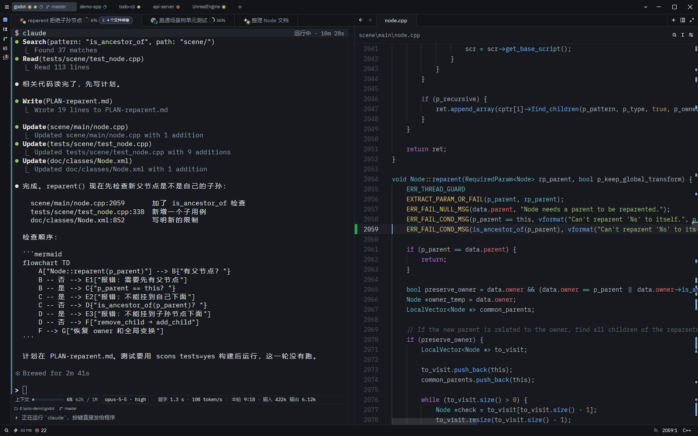

### agent 状态一眼看清

运行 agent 的终端，标签上是 agent 的图标、会话名和红绿灯一样的状态点：蓝色在工作，黄色等你回复，绿色做完一轮待你看，红色出错；后面是上下文用了多少。悬停看到模型和思考强度、上下文、目录和分支、这一轮和整个会话的 token 和用时，以及首字时间和输出速度。Solo 在后台时，agent 需要你回复会发桌面通知。

Claude Code、Codex、Copilot CLI 通过 Solo 为这次会话加的 hooks 上报状态，OpenCode 通过 Solo 加的插件，都不改它们的配置；其他 agent 按各自的屏幕规则识别。

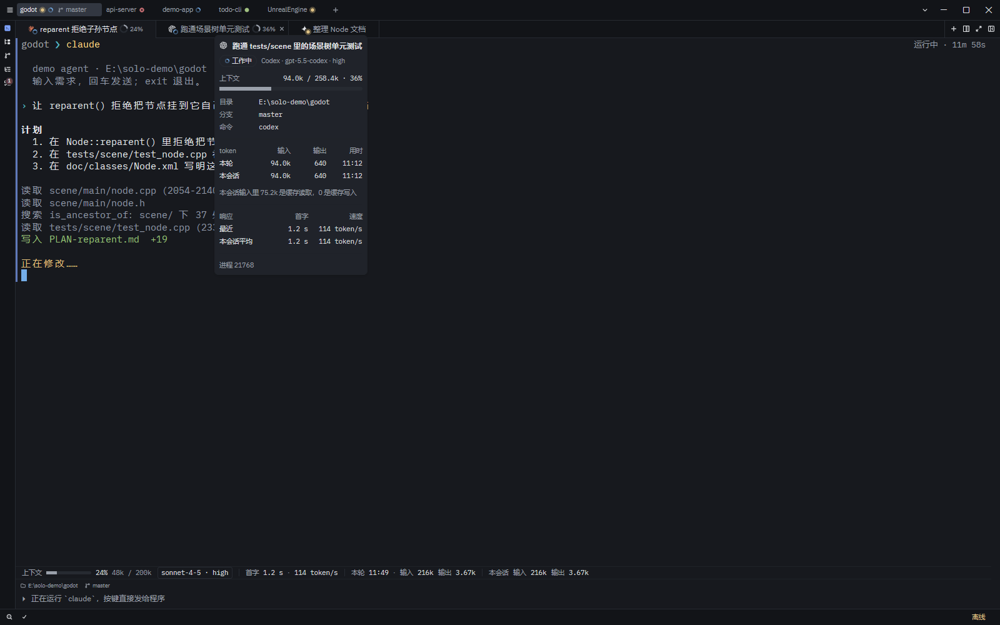

不确定状态对不对时，在终端里右键选"为什么是这个 agent 状态？"，Solo 说明它来自 hook 上报、程序退出还是屏幕规则，以及最后一次上报和输出是什么时候。

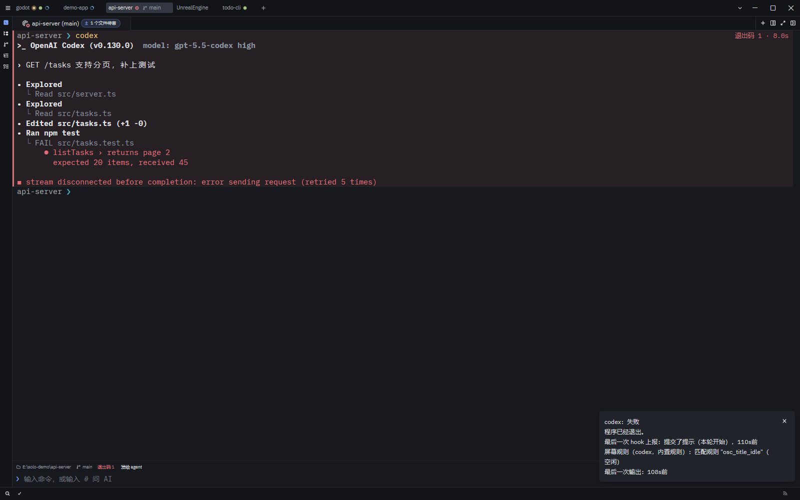

### 工作区标签：按项目分开

每个项目文件夹是一个工作区，标题栏上一个标签，里面有它自己的终端、agent、编辑器和文件树；切换标签，这些一起换。标签上显示这个项目里 agent 的状态，后台项目有 agent 在等你也看得到；标签菜单列出它的终端，点一下直接跳过去。`Ctrl+Alt+1…9` 切换，重启后所有标签都回来。

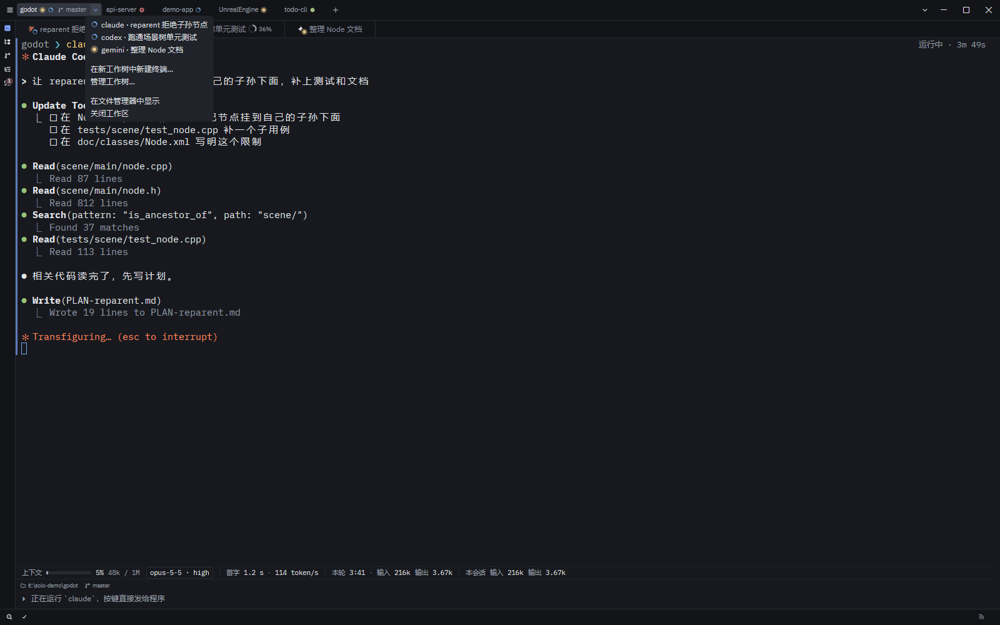

### 待审改动和回滚

agent 改的东西在你认可之前都是待审的，终端标签上显示"N 个文件待审"。点开后每个文件只和你上次认可时的样子比，几轮的改动一起审，每块标出是哪一轮改的：逐块保留或拒绝（后面的轮次又改了同一个文件也行），在代码行上写意见，连同拒绝了哪些一次发给 agent。没处理的改动到下一轮结束时自动算保留；你自己改的和提交进 git 的不算待审。Solo 还会告诉你这一轮**新增**了几个错误和警告、修掉了几个。可以回滚到任意一轮之前，回滚本身也能撤销；快照存在 Solo 自己的目录里，不碰你的分支、暂存区和 stash。[详细 →](docs/site/zh/features/review.md)

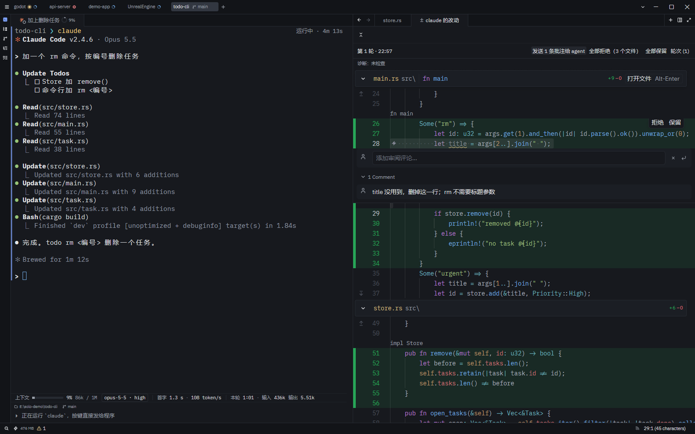

### Agent 时间线

Claude Code 和 Codex 的会话按轮列出：每一轮的提示、读过和改过的文件、运行的命令和回答，点文件直接打开。在终端标签上右键选"Agent 时间线"。

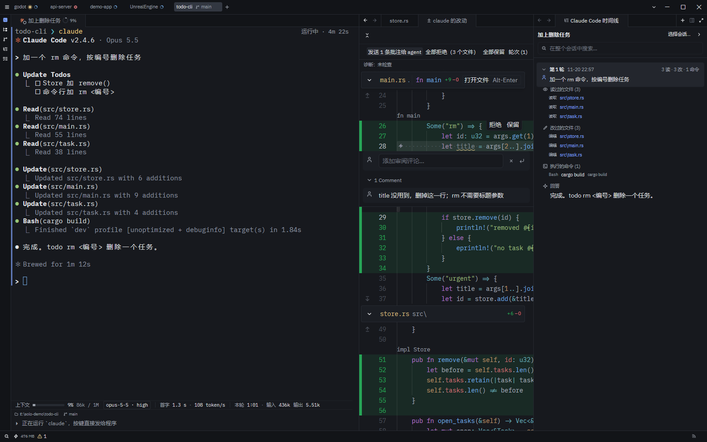

### 更新重启、甚至崩溃，都不打断 agent

每个终端的 shell 跑在一个小的后台进程里。Solo 更新重启，甚至崩溃，正在运行的 agent 和编译都会继续；Solo 再打开时自动连回去，画面、期间的输出和 agent 的状态都在。自己退出 Solo 时，有 agent 在跑会先问，和关窗口一样，确认后结束它们（设置 `terminal.keep_running_on_quit` 可以让它们继续跑）。空闲的 shell 随 Solo 一起结束。没能保留下来的 agent，重启后会提示接着上次的会话。

### 终端里的链接一点就开

终端输出里的文件路径，点一下就打开：代码在编辑器里，Markdown 在渲染好的预览里（Mermaid 图和图片都显示），图片在图片查看器里。agent 说"改了 src/app.ts:42"，点一下就跳到那一行；输出里只有行号（比如 `(:120)`）时，Solo 会到前面提到的文件里找有这一行的那个打开。

Solo 不该直接打开的链接，点了先弹一个小菜单：外部网址（在浏览器或 Solo 里打开、复制链接），Solo 打不开的文件比如 `.apk`、`.dll`（用默认程序打开、在文件资源管理器中显示、复制路径），同名文件猜不准是哪个时（选一个），只在别的项目标签里有的文件（切到那个标签）。Solo 能预览的文件也先问，第一项是预览：HTML（在 Solo 浏览器中打开、打开源文件、用默认程序打开）、CSV/TSV/PSV/SSV 表格（表格预览）、SVG 图片（图片预览），以及 PDF（在 Solo 浏览器中打开）；Markdown 仍然直接打开预览。`Ctrl`+点击直接执行菜单第一项（能预览的文件就是预览），但第一项会把文件交给别的程序的（比如 Solo 打不开的文件），只会在文件资源管理器中显示，不会交给别的程序打开；程序和快捷方式（`.exe`、`.lnk` 等）菜单里的“运行”排在最后。设置 `terminal.link_menu`（设置 › 终端 › “点链接时弹出菜单”）可以改成所有链接都弹（`always`）或都不弹（`never`）。

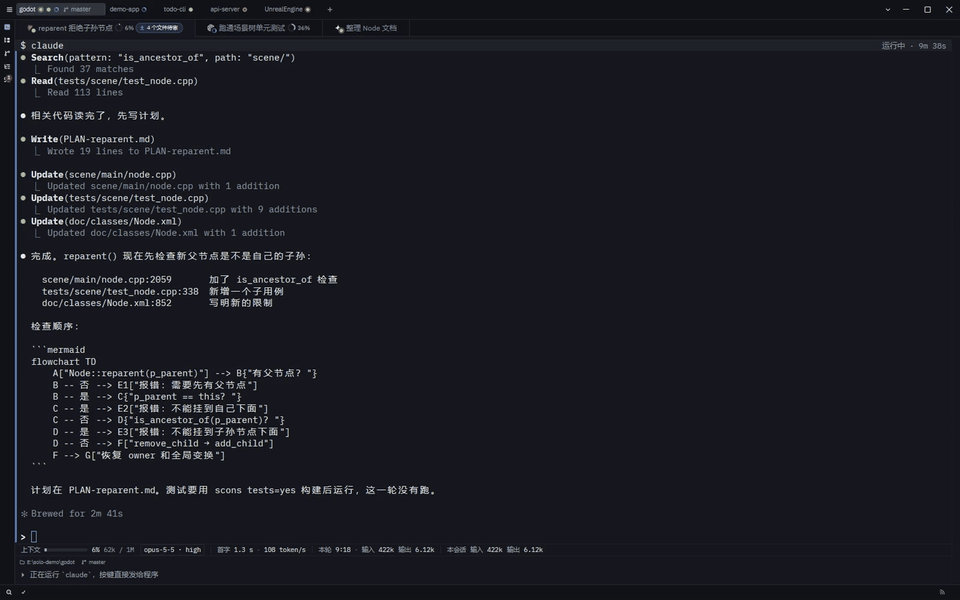

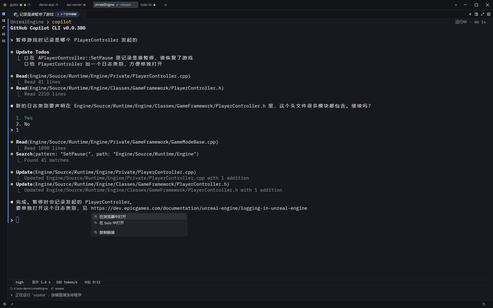

### Mermaid 图和文档审阅

agent 输出里的 `mermaid` 代码块，点 `mermaid` 那一行就能看图；屏幕上只显示了一部分时，Solo 从 agent 的会话记录里取完整内容。Markdown 预览里的 Mermaid 图也直接渲染。

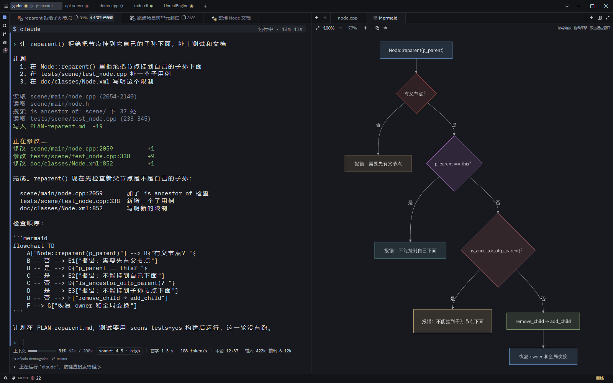

agent 写的计划和设计文档在预览里打开，选中文字写批注，一次发回给 agent；文档再被改时，Solo 告诉你改了哪几块。[详细 →](docs/site/zh/features/documents.md)

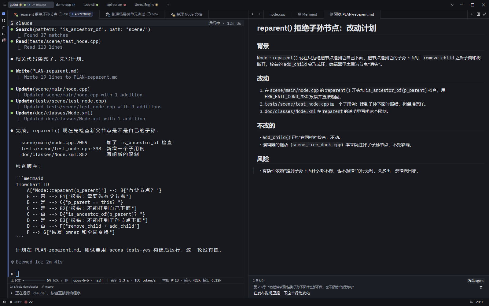

### 好几个 agent 同时干活

一个任务一个 git worktree 和分支，互不干扰，做完合并、开 PR 或丢弃；工作区里有几个仓库时，一个任务可以横跨它们。左侧的 agent 看板列出所有 agent 和任务，等你回复的排在最前面。终端里的 agent 也能用 `solo-cli agent` 查看、等待别的 agent，给它们发消息，或者新开任务。[详细 →](docs/site/zh/features/parallel.md)

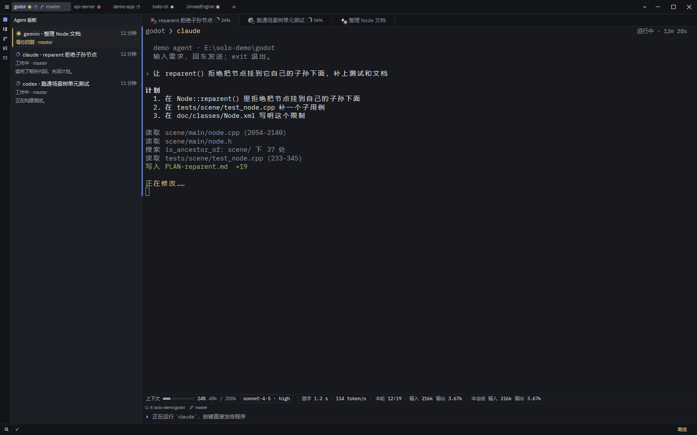

### 内置浏览器

本机地址（localhost 等）的链接在 Solo 里打开，开发时不用切窗口。在网页上点选元素、写批注，一次发给 agent，带上选择器、HTML、样式和截图。打开设置后，Solo 终端里启动的 agent 还能在这个浏览器里打开网页、点击、填表、截图，你看着它操作。[详细 →](docs/site/zh/features/browser.md)

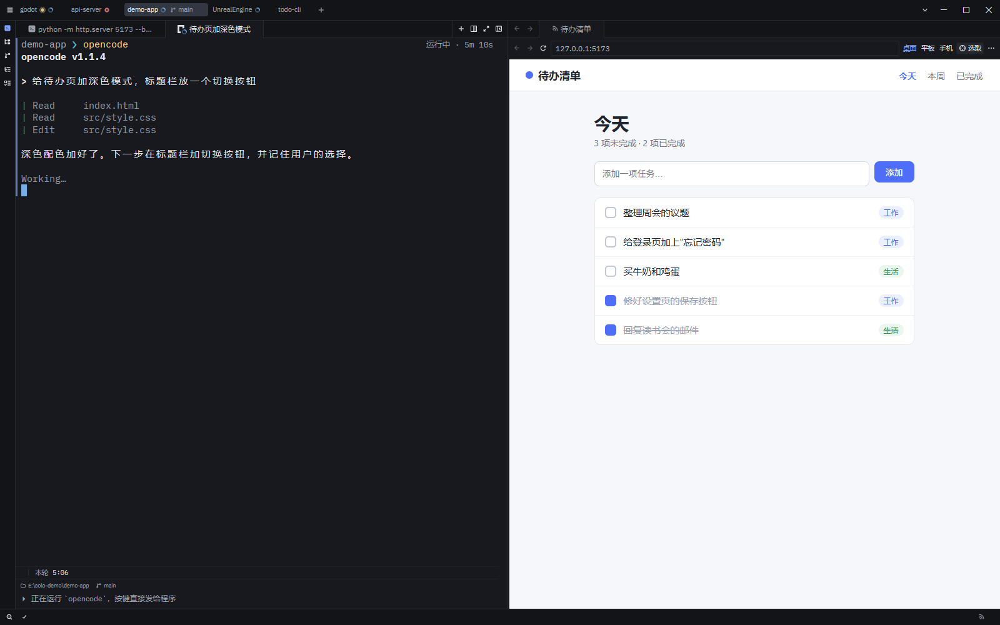

### 好用的终端

命令块、底部的输入编辑器、边输边弹的补全、失败的命令一键把错误发给 agent，还能用一句话让你自己的 Claude Code 或 Codex 给出命令。[详细 →](docs/site/zh/features/terminal.md)

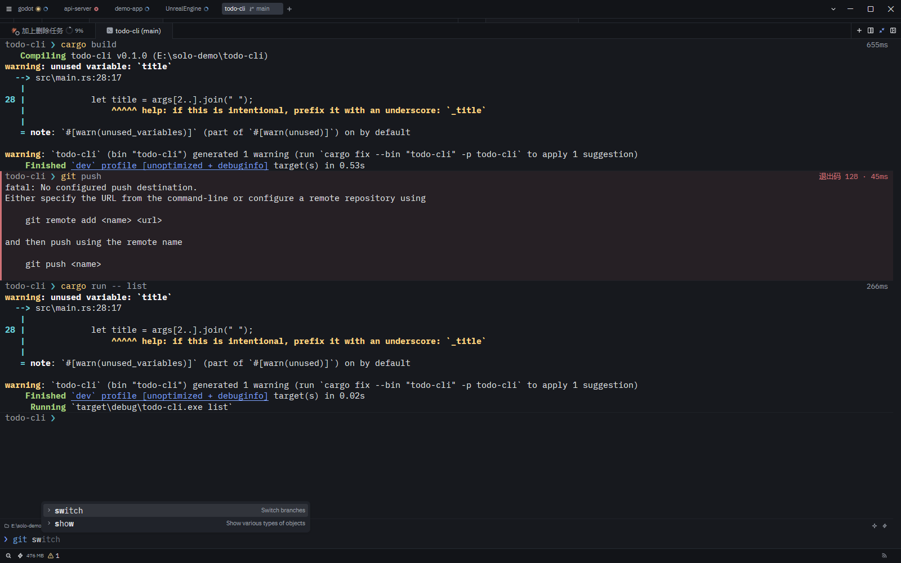

### 下载前先问，也能离线

语言服务、Node.js 这类东西第一次下载前，Solo 先问一次，写明从哪里下载；可以全部允许并记住、逐个选择，或者指定本机已有的路径。状态栏右边的按钮切到离线模式，Solo 就只连本机和局域网。

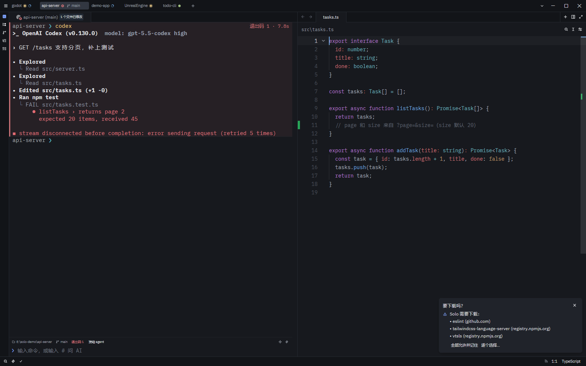

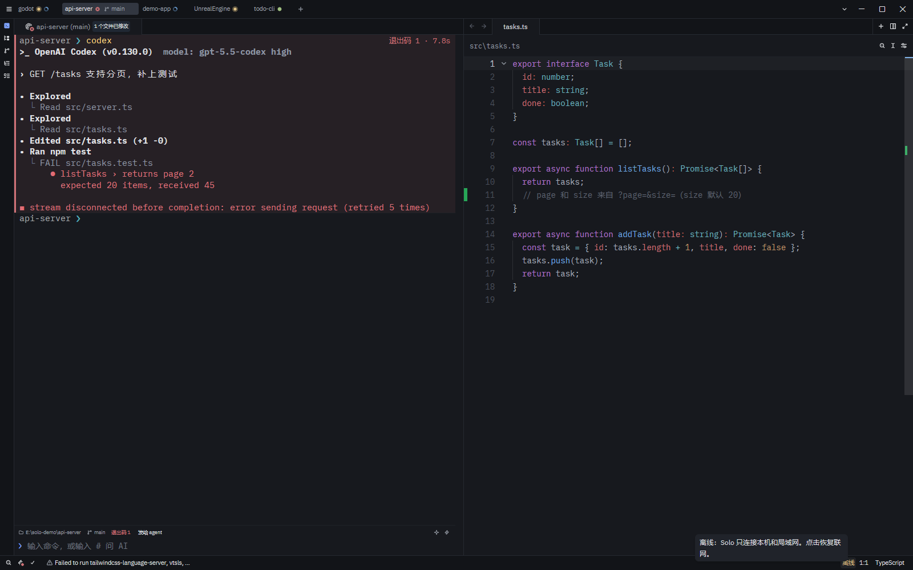

### 在 Solo 里更新

有新版本时标题栏右边出现更新按钮，不弹通知；菜单里有这一版的简介，可以更新并重启、退出时再装、看更新内容或跳过这个版本。

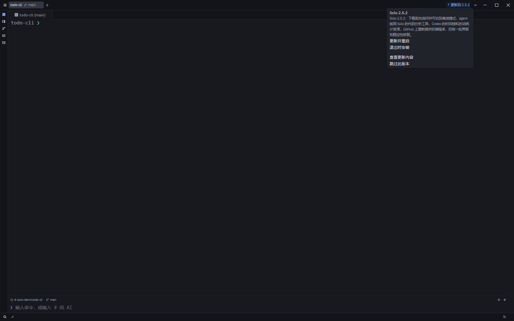

### 全部功能

**终端**

- **命令块**：每条命令和输出是一块，带退出码和耗时，失败的标红，正在跑的有计时，长输出滚动时命令固定在顶部。选中一块可以复制命令或输出、重新运行，或按 `Alt+Enter` 发给另一个终端里的 agent。
- **失败了交给 agent**：命令失败时点"发给 agent"，Solo 只挑出编译错误、失败的测试和断言（cargo、tsc、gcc/clang、MSVC、pytest、go、jest），其他情况取输出的最后一段，粘贴给在同一目录里工作的 agent。
- **输入编辑器**：命令在底部的真编辑器里输入，多光标、撤销、`Shift+Enter` 换行、语法高亮都能用。
- **边输边补全**：约 500 个常用命令的子命令、选项和参数值（git 分支、npm 脚本、docker 容器等），另有 PowerShell 自己的补全；灰色提示来自历史和命令规格，`Ctrl+R` 模糊搜索历史。
- **`# 想做的事`**：用一句话描述，你自己的 Claude Code 或 Codex 给出命令（生成时关掉了它们的工具），你确认后才运行；可以带上刚才失败的命令和输出。
- **工作流**：保存带 `{{参数}}` 的常用命令，`Ctrl+Shift+R` 调出，也能从 + 菜单在新终端里运行。
- **shell**：PowerShell、bash、zsh、fish。重启后终端按原来的目录和标题重新打开。和 Windows Terminal 一样，新开的终端从系统当前的设置读取 `PATH` 等环境变量，Solo 开着时新装的程序（或者启动 Solo 的程序没传过来的路径）不用重启 Solo 就能找到。
- 终端栏可以隐藏，里面的 agent 照常运行；隐藏时左边的终端图标上显示有几个 agent 要你看一眼。

**agent 和状态**

- 二十多种 agent 自动识别，不用配置；别的程序可以用 `agent_commands` 加进来，或者按[状态协议](docs/agent-status-protocol.md)自己上报。
- 终端标签：agent 图标、会话名、红绿灯状态点、上下文圆环和百分比；悬停卡片和终端底部的用量栏显示模型、思考强度、token、本轮用时、首字时间和输出速度。
- 桌面通知（Solo 在后台时）：agent 需要你回复、程序发通知、长命令跑完，以及（默认关）agent 停下；每种各有开关。
- **agent 看板**：左侧栏列出所有 agent 终端和 agent 任务，带状态、分支、上一轮的改动、运行时长和最后一句话，点一下跳到终端。任务的 PR 会用 `gh` 跟进：检查、新评论和能不能合并显示在看板上，有事要处理时发通知，新的反馈可以发给 agent（也可以设成自动）。
- **时间线**（Claude Code、Codex）：每一轮的提示词、读过和改过的文件、跑过的命令和回答。
- **把东西发给 agent**：编辑器里 `Ctrl+Alt+K` 发送选中内容或光标位置，`Ctrl+Alt+Shift+M` 发送当前文件的诊断信息。
- **给 agent 的代码分析工具**：Solo 终端里的 Claude Code 和 Codex 能调用 Solo 正在跑的语言服务：查找符号、跳到定义、查找引用、看诊断；只读，只限当前工作区（`terminal.ide_tools` 可关）。
- **为什么是这个状态**：终端标签右键"为什么是这个 agent 状态？"，说明状态是 hook 上报的还是读屏幕判断的、最后一次上报在什么时候；agent 也能用 `solo-cli agent why` 查。
- 关闭正在跑 agent 的终端或窗口前先确认。

**工作区**

- 一个项目文件夹一个工作区标签，各有自己的终端、agent、编辑器和文件树；标签上显示 agent 的状态，菜单里列出终端。
- 终端 `cd` 到了别的项目，标签上有标记，顶部提示可以把它移到对应的标签（不打断正在跑的程序）；也可以随时"移到标签"。
- 一个工作区里有互不相关的项目时，可以拆成几个标签。
- 在资源管理器里右键文件或文件夹"通过 Solo 打开"，放进已有的窗口和对应的标签。

**审阅和回滚**

- 每一轮的改动：逐块保留或拒绝、全部保留或拒绝；拒绝这一轮新建的文件时移到回收站。
- 在代码行上写意见，一次发回给 agent。
- 这一轮新增和修掉了几个错误、警告，点一下跳过去。
- 审阅里能跳到定义、查引用、搜索，每块改动上方写着它在哪个函数里。
- 回滚到任意一轮之前，回滚也能撤销；中途失败会保留撤销点。
- agent 上报了自己改的文件时（Claude Code，Codex 从它发给 Solo 的运行记录里读出），一轮只算它改的，你自己或别的 agent 同时改的单独列出，"全部拒绝"不会动它们。
- 不是 git 仓库或文件太多拍不了快照时，仍列出这一轮改了哪些文件。
- 超过 50 MB 的未跟踪文件不进快照，审阅里会注明，回滚不会动它们。旧快照自动清理，总共不超过 4 GB。

**编辑器**

- Zed 的编辑器：语言服务、跳到定义、查找引用、全项目搜索、多光标、Git 面板、diff 和 blame。
- 大仓库里语言服务默认更省资源；状态栏显示它们占了多少内存，可以按项目选完整分析、只分析打开的文件或关掉；占内存多时提醒；起不来时写明原因。

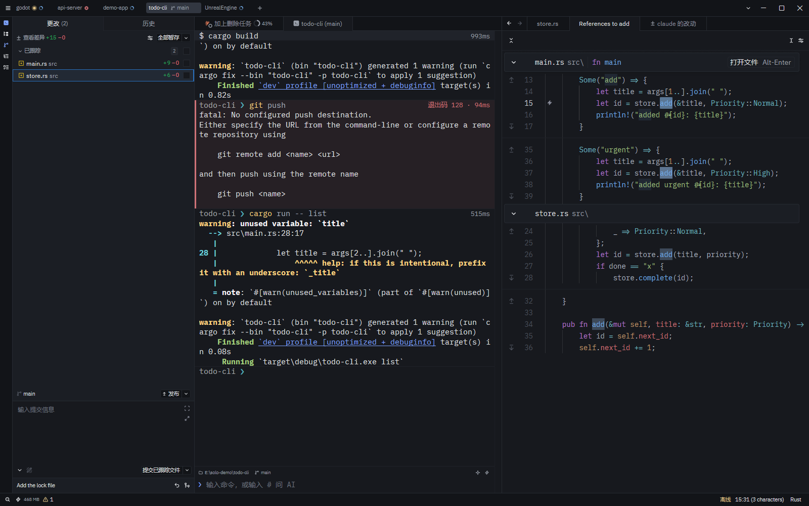

**文档、Markdown 和图**

- 终端输出里的路径点一下打开：代码、Markdown 预览、图片查看器；只有行号的链接也能找到对的文件。
- agent 输出里的 Mermaid 代码块直接看图，Markdown 预览里的 Mermaid 图和图片也会显示。
- 在 Markdown 预览里批注，一次发给 agent；文档之后又被改了，提示改了多少，"显示改动"标出改过的段落。
- Solo 打不开的文件（比如 .apk）显示完整路径，可以"在文件资源管理器中显示"或用默认应用打开。

**内置浏览器**

- 终端、Markdown 预览、时间线里的网页链接：本机地址默认在 Solo 里打开，其他用系统浏览器（`browser.open_links` 可改）；`Ctrl+Shift`+点击换另一种方式。
- 工具栏：前进后退、地址栏、桌面/平板/手机视口、开发者工具、页内查找。
- **选取**：点网页元素写批注，编号显示在页面上，"发送给 agent"粘贴到 agent 的输入里（不自动发送）。
- **让 agent 操作浏览器**（`browser.allow_agent_control`，默认关）：Claude Code 和 Codex 自动接上 Playwright MCP（需要 Node.js），在 Solo 的浏览器里打开、读取、点击、截图。

**并行任务和 agent 命令行**

- **agent 任务**：一个任务一个分支和 git worktree，在里面开终端启动 agent；做完合并回原分支、开 PR 或删除；有没提交的改动时可以让 agent 自己提交。
- 一个任务可以横跨工作区里的几个仓库。
- 仓库里的 `.solo/worktrees.json` 决定 worktree 放在哪、复制哪些被忽略的文件（比如 `.env`）、启动前后跑什么命令、每个任务分一个端口。
- + 菜单里可以直接"在新工作树中新建终端"，选开一个空 shell 或任一装了的 agent。
- **安装 agent…**（+ 菜单、空的终端栏、命令面板）列出 Solo 能接状态的 11 种 agent：装了的显示版本，没装的有"安装"按钮，把安装命令填进新终端的输入框，不自动运行。+ 菜单里列出装了的 agent。
- **`solo-cli agent`**：终端里的 agent 可以列出别的终端、给它们发消息、等它们做完、读它们的回答，或者新开一个任务（[说明](docs/agent-cli.md)）；`agent_control` 设置限制它能做到什么程度。

**终端常驻**

- 跑着 agent 或命令的终端在 Solo 更新重启、崩溃后继续运行，重新打开时连回去，画面完整恢复，agent 照样认得出来。正常退出 Solo 时有 agent 在跑会先问，确认后结束。
- 没能保留下来的 agent 终端，重启后提示接着上次的会话（Claude Code、Codex、Copilot CLI、OpenCode、Gemini CLI、Cursor CLI、Aider）。

**更新**

- 在 Solo 里更新，不打开商店；有新版本时标题栏右边出现更新按钮，不弹通知。
- 可以"更新并重启"或"退出时安装"，有 agent 在跑时会说明现在更新会影响哪些；也可以看更新内容或跳过这个版本。

**设置和其他**

- 中文和英文界面（`ui_language`，默认跟随系统）。
- 设置页里能改终端、通知、语言服务等；设置和数据放在 Solo 自己的目录里，和 Zed 分开。
- 不用注册账号，不发送遥测；默认只检查更新。
- **下载前先询问**：语言服务、Node.js、Prettier、调试器等第一次下载前问一次，写明从哪里下载，可以记住、暂不下载或指定本机路径（`downloads.mode`）。
- **离线模式**：状态栏右侧的按钮或 `network.offline`，打开后只访问本机和局域网，不安装任何东西，已经装好的照常用。

**开发中**

- 手机端：在手机上查看和控制电脑上的 agent。

## 支持的 agent

| agent | 状态从哪里来 | 按轮审阅 | 重启后接着用 |
|---|---|---|---|
| Claude Code、Codex、Copilot CLI | Solo 加的 hooks，准确上报 | 支持 | 接最近一次会话 |
| OpenCode | Solo 加的插件，准确上报 | 支持 | 接回原来的会话 |
| Gemini CLI、Qwen Code | Solo 为这次会话加的 hooks（系统默认设置文件），准确上报 | 支持 | 接回原来的会话 |
| Pi、oh-my-pi | Solo 用 `-e` 加载的扩展，准确上报 | 支持 | 接回原来的会话 |
| Kilo Code CLI | Solo 的插件目录（`KILO_CONFIG_DIR`），准确上报 | 支持 | 接回原来的会话 |
| Kimi Code CLI、MastraCode | 在设置 `global_agent_hooks` 里逐个开启后写入它们的配置（先备份，可干净移除）；未开启时读屏幕（Kimi）或终端输出 | 支持 | 开启后接回原来的会话 |
| Cursor CLI | 读屏幕 | 支持 | 接最近一次会话 |
| Amp、Cline、Droid 等其余有规则的 agent | 读屏幕 | 支持 | 不支持 |
| Aider 和用 `agent_commands` 加的程序 | 终端输出 | 不支持 | Aider 恢复聊天记录，其他不支持 |
| 其他程序 | [状态协议](docs/agent-status-protocol.md) | 支持 | 不支持 |

完整列表见[功能参考](docs/reference.md#supported-agents)。

## 安装

Solo 目前只有 Windows x64 版，有两种装法，装一种就够了：

1. **GitHub 安装程序**：从 [GitHub Releases](https://github.com/lucas9801/solo/releases/latest) 下载 `Solo-Setup-<版本>.exe`。它没有签名，运行时 Windows 的 SmartScreen 会提示“Windows 已保护你的电脑”：点“更多信息”，再点“仍要运行”。安装时可以选择安装目录（默认 `%LOCALAPPDATA%\Programs\Solo`），装好后 Solo 自己更新。
2. **Microsoft Store**：[下载 Solo Code 的安装程序](https://get.microsoft.com/installer/download/9NBW452JVWN6)，运行后直接装好 Solo Code，不打开商店应用。链接下载不了时，打开 [Solo Code 的商店页面](https://apps.microsoft.com/detail/9NBW452JVWN6)安装。商店版由微软签名，通过商店更新，版本可能比 GitHub 晚一个。想装到别的盘：在“设置 → 系统 → 存储 → 高级存储设置 → 保存新内容的地方”里把“新的应用将保存到”改成那个盘再安装，或者装好后在“设置 → 应用”里移动 Solo Code（菜单名称按微软的说明写的，没有实测）。

**开始用**：打开 Solo，打开一个项目文件夹，在终端里运行 `claude`、`codex` 或你常用的 agent（agent 要你自己先装好）。

**更新**：在 Solo 里完成：商店版通过商店更新，不打开商店；GitHub 安装版下载新版本的安装程序并静默安装。Solo 启动 30 秒后检查一次，之后每小时一次。有新版本时标题栏最右边出现更新按钮（不弹通知），你同意了才会更新；有 agent 在跑时可以选"退出时安装"，选了之后按钮消失，退出 Solo 时安装（手动检查更新时会再出现）。不想自动检查，在设置里写 `"auto_update": false`。

**卸载**：在"设置 → 应用"里卸载 Solo Code（商店版）或 Solo（GitHub 安装版）。卸载不会删除设置和数据，彻底清除的方法见[用户指南](docs/guide/zh-CN.md#4-卸载与彻底清除)。

## 从源码编译

**需要准备**（Windows x64）：

- Git。
- Rust：用 [rustup](https://rustup.rs) 安装，也可以运行 `script\install-rustup.ps1`。仓库的 `rust-toolchain.toml` 固定了编译器版本（1.98.1），第一次构建时 rustup 会自动装上。
- Visual Studio 2022 或更新版本（或只装 Build Tools 加"使用 C++ 的桌面开发"工作负载），勾上这些组件：**MSVC x64/x86 生成工具**、**MSVC x64/x86 Spectre 缓解库**、**Windows SDK（至少 10.0.20348.0）**、**CMake**（"用于 Windows 的 C++ CMake 工具"）。只装 Build Tools 时，要在开始菜单里的"Developer PowerShell"里编译。组件 ID 和常见问题见 [Zed 的 Windows 构建说明](https://github.com/zed-industries/zed/blob/main/docs/src/development/windows.md)。
- 磁盘空间：至少留 40 GB。实测一次发行构建占 14 GB，Rust 工具链和 cargo 下载的源码约 6 GB；调试构建的 `target\debug` 会随着反复编译越积越大。测法见[从源码构建](docs/development.md#notes-for-local-builds)。

**开发构建**：

```powershell
git clone https://github.com/lucas9801/solo
cd solo
cargo run -p solo        # 调试版，生成并运行 target\debug\solo.exe
```

这样只编译 `solo.exe`。agent hooks 用的 `solo-agent-hook.exe`、让终端在 Solo 关掉后继续跑的 `solo-terminal-host.exe` 和 `solo-cli.exe` 要另外编译，见[从源码构建](docs/development.md#notes-for-local-builds)；没有它们 Solo 也能用，只是这几项退回到慢一些或不保留的做法。

**发行构建和打包**：

```powershell
script\package-solo.ps1   # 优化构建，把要打包的文件放到 dist\Solo
```

脚本会先生成依赖的许可清单（需要时自动安装 cargo-about）。可选参数：`-TargetDir`（cargo 输出目录）、`-OutDir`（输出目录，默认 `dist`）。商店包用 `script\package-solo-msix.ps1` 从 `dist\Solo` 生成；GitHub 安装程序用 `script\package-solo.ps1 -Step Installer` 生成（需要 Inno Setup 6）。见[从源码构建](docs/development.md)。

**注意**：

- 第一次构建要下载依赖、编译一千多个 crate，时间较长（几十分钟到几个小时，看机器）。编译时会同时跑很多个 rustc，每个可能占到 1 GB 以上；内存紧张时用 `cargo run -j 4 -p solo` 或环境变量 `CARGO_BUILD_JOBS` 限制并发。
- 正式版本由 GitHub Actions 构建和打包（[Solo package](.github/workflows/solo-package.yml)），本地构建只用来开发和测试。

## 现在的状态

- **只有 Windows 版。**
- **不用注册账号，不发送遥测。** 默认只会定期检查更新（可以关掉），其余网络访问都由你用到的功能触发，详见[隐私说明](docs/guide/zh-CN.md#9-隐私与网络)。
- **开源**，GPL-3.0。

## 更多文档

- [用户指南](docs/guide/zh-CN.md)（[English](docs/guide/en.md)）：所有功能和设置的说明
- [功能参考（英文）](docs/reference.md)：完整功能清单、设置项、agent 支持表
- [agent 状态协议](docs/agent-status-protocol.md)、[给 agent 用的命令行](docs/agent-cli.md)
- [从源码构建](docs/development.md)：构建细节，版本怎么构建和发布
- [包里有哪些文件](docs/package-contents.md)：每个文件的来源和许可证
- [签名、版本信息和网络访问](docs/code-signing-policy.md)：商店包由谁签名，Solo 会主动访问哪些网络

## 致谢与许可

Solo 基于 Zed Industries 的 [Zed](https://github.com/zed-industries/zed)。和 Zed 一样采用 GPL-3.0-or-later 许可（见 `LICENSE-GPL`）；部分 Zed crate 是 Apache-2.0（见 `LICENSE-APACHE` 和各 crate 的许可文件）。

内置的第三方代码，本地改动都标有 `SOLO:`（见 [`vendor/README.md`](vendor/README.md)）：

- [alacritty_terminal](https://github.com/alacritty/alacritty)（Apache-2.0），来自 Zed 的分支
- [vte](https://github.com/alacritty/vte)（Apache-2.0 / MIT）
- [Warp 的 command signatures](https://github.com/warpdotdev/command-signatures)（MIT，很多规格改编自 Fig，同为 MIT）
- [Herdr 的 agent 屏幕识别规则](https://github.com/herdrdev/herdr)（Apache-2.0，未修改）

Solo 与 Zed Industries、Warp 没有关联。没有使用 Warp 终端应用的代码（AGPL），相关功能是重新实现的。
