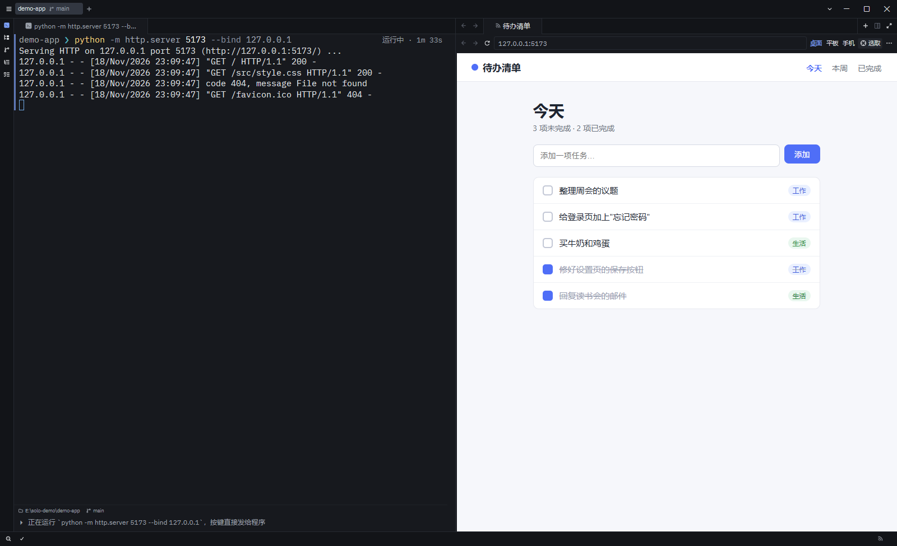

# The built-in browser

[← Home](../index.md)

When you build a web page, you check the agent's work in a browser and come back to describe what's wrong. Solo puts the browser next to the terminal, and you point at the problem on the page itself and send it to the agent.

## Opening pages

- `ctrl`-click a web link in a terminal, the Markdown preview or the timeline. Local addresses (localhost, 127.0.0.1 and so on) open in Solo by default and the rest in the system browser; `ctrl-shift`-click opens a link the other way. Settings > Browser > **Open Links In** can send all links to one or the other.
- Pages open in a tab of the editor area, next to the terminal, shown by the Microsoft Edge WebView2 runtime that comes with Windows 11.
- A page that is already open is switched to rather than opened again, and open pages come back after a restart.

## The toolbar

Back, forward, reload, the address (`5173` means `http://localhost:5173/`), desktop, tablet and phone viewports, **Pick**, and the `...` menu: developer tools (`f12`), find in page (`ctrl-f`), open in the system browser, copy address.

## Comments on the page

1. Click **Pick**: the element under the mouse is outlined with its selector and size.
2. Click an element (the page's own click handlers don't run) and write your comment. Elements with comments get a number on the page; click it to change or delete the comment.
3. **Send to Agent · n** pastes all the comments into the prompt of the agent used last (without sending it); the arrow next to it lets you choose another agent.

Each comment comes with the element's selector, text, HTML, a few computed styles and the path of a screenshot of the element, so the agent knows exactly which part you mean. After a reload or a hot update, Solo finds the elements again by their selectors.

## Letting agents use the browser

With Settings > Browser > **Allow Agents to Control the Browser** on (off by default; takes effect after Solo restarts), Claude Code and Codex started afterwards in Solo's terminals get Playwright MCP (Node.js is needed) and can open pages, read them, click, fill in forms and take screenshots in this browser while you watch. Other agents can connect through the terminal's `SOLO_BROWSER_CDP`.

This also lets agents use pages you are signed in to, and any program on this computer that finds the debugging port can do the same, so turn it on only while you need it. See the [user guide](../../../guide/en.md#the-browser) for details.
