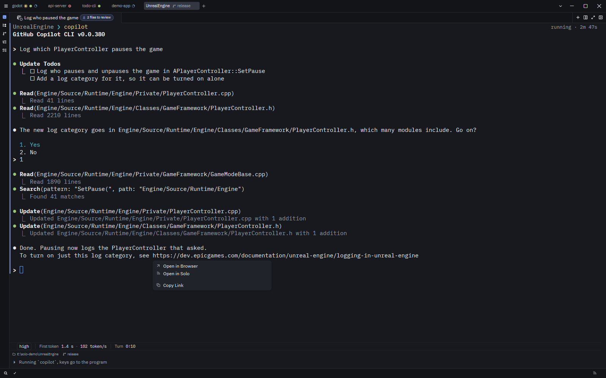

# Solo

**Agents write the code. You read it, judge it and direct them.**

Solo is an editor for working with AI agents, built on [Zed](https://github.com/zed-industries/zed). The terminal fills the window, and agents like Claude Code and Codex run in it as they always do, with your own command-line tools and subscriptions. When you need to look at code, a full editor opens on the right.

It's made for people who still read the code and the documents themselves: after each turn of an agent, you see what it changed and whether it broke anything, keep or undo it, and send it your comments.

[Download the Windows x64 installer](https://github.com/lucas9801/solo/releases/latest/download/Solo-Setup.exe) ([all releases](https://github.com/lucas9801/solo/releases); unsigned: when SmartScreen warns, click "More info", then "Run anyway") · [Microsoft Store](https://get.microsoft.com/installer/download/9NBW452JVWN6) ([Store page](https://apps.microsoft.com/detail/9NBW452JVWN6); signed by Microsoft, updated through the Store, may be a version behind) · [User guide](../../guide/en.md) · [Compared with other tools](compare/index.md) · [中文](../zh/index.md)

https://github.com/user-attachments/assets/85627f07-1bb5-4f68-8199-c3afbdc9fa3b

---

## Read: what the agent changed, at a glance

- **Pending changes.** What an agent changed is pending until you accept it; its terminal tab shows "N files to review". Open it to see each file against what you last accepted, keep or reject each hunk, comment on lines and send the comments and what you rejected back at once. [More →](features/review.md)
- **Diagnostics per turn.** After a turn, Solo has the language servers check the changed files and tells you how many errors and warnings the turn **added**, and how many it fixed.
- **Navigate while reviewing.** The review is an editor: go to definition, find references and search all work, and each hunk is labeled with the function it's in.
- **Click to look.** A file path in the terminal's output opens with a click: code in the editor, Markdown in a rendered preview, images in the image viewer. A `mermaid` block in an agent's output opens as a diagram. External web addresses, files Solo can't open, a file name several files have and files only another project tab has show a small menu instead (`terminal.link_menu`).

  

- **Documents too.** Plans and designs the agent writes open in a rendered preview (Mermaid diagrams included). Select text, comment, and send the comments back together; when the document changes again, Solo tells you which parts. [More →](features/documents.md)

## Judge: keep or undo, safely

- Snapshots live in Solo's own folder; your branch, index and stash are never touched. Untracked files over 50 MB are left out, and old snapshots are cleaned up automatically.
- **Roll back to before any turn**, and undo the rollback if you change your mind; a rollback that fails partway keeps the undo point.
- When the agent reports the files it edits (Claude Code does), a turn is only those files: what you or another agent changed meanwhile isn't undone.
- Works with more than twenty agents: Claude Code, Codex, Copilot CLI and OpenCode report through hooks or a plugin Solo adds for each session (their config is left alone); the others are recognized from their screen.

## Direct: several agents at once

- **See who's doing what:** a terminal tab shows the agent's logo, its session name, a traffic-light status (working, waiting for you, done, failed) and its context use; hover it for the model, tokens, time to first token and output speed. With Solo in the background, an agent waiting for you sends a desktop notification.
- **Workspace tabs:** one tab per project, switching terminals, editors and the file tree together; each tab shows its agents' status, including those in the background.
- **Agent board:** a sidebar listing every agent and task, those waiting for you first.
- **Agent tasks:** each task gets its own git worktree and branch, so agents don't step on each other; merge it, open a pull request or discard it when done. A task can span several repositories in one workspace. [More →](features/parallel.md)
- **Built-in browser:** local pages open in a tab next to the terminal; pick elements on the page, comment on them and send the comments to an agent with their selectors, HTML and screenshots. With a setting on, agents can open pages, click and take screenshots in it while you watch. [More →](features/browser.md)
- **Agents can drive Solo:** an agent in a Solo terminal can list, wait for and message the others, or start a new task, with `solo-cli agent`.

## A good terminal, too

Command blocks, an input editor at the bottom, completions as you type, a failed command's errors sent to an agent in one click, and a command from a sentence by your own Claude Code or Codex. [More →](features/terminal.md)

For the full feature list, see the [feature reference](../../reference.md).

---

## Where it stands

- **Windows only**, installed with the [installer on GitHub](https://github.com/lucas9801/solo/releases/latest) (unsigned) or from the [Microsoft Store](https://get.microsoft.com/installer/download/9NBW452JVWN6) ([Store page](https://apps.microsoft.com/detail/9NBW452JVWN6)), and updated inside Solo.
- **Updates, even crashes, don't stop your agents.** Each terminal's shell runs in a small background process; an update's restart or even a crash of Solo leaves terminals that are running something (an agent, a build) running, and Solo connects to them again when it opens, screen and agent status and all. Quitting Solo yourself asks first when agents are running, then ends them. Idle shells end with Solo as usual.
- No account, no telemetry. By default Solo only checks for updates (which can be turned off); everything else happens when you use a feature. See [privacy](../../guide/en.md#9-privacy-and-network). Solo asks before downloading a language server or other tool, and an offline mode keeps it to this computer and the local network.
- Voice input (`Ctrl+Alt+M`) recognizes speech on this computer, filling the text in where you were typing without sending it; its model is downloaded after asking, and no sound is saved or uploaded.
- Open source, GPL-3.0.
