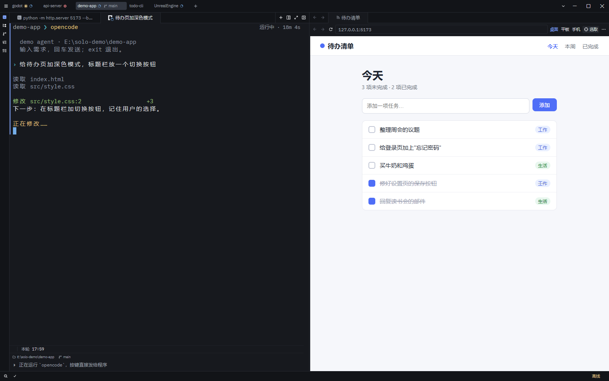

# 内置浏览器

[← 首页](../index.md)

做网页时，agent 改完代码你要去浏览器里看效果，看到问题再回来描述给它。Solo 把浏览器放在终端旁边，看到哪里不对，直接在页面上点出来发给 agent。

## 打开网页

- 终端、Markdown 预览、时间线里的网页链接，`ctrl`+点击就能打开。本机地址（localhost、127.0.0.1 等）默认在 Solo 里打开，其他网址用系统浏览器；`ctrl+shift`+点击换另一种方式。设置 › 浏览器 › **链接打开方式** 可以改成都用 Solo 或都用系统浏览器。
- 网页在编辑区的标签页里打开，放在终端旁边，用的是 Windows 11 自带的 Microsoft Edge WebView2。
- 同一个网址已经开着时会切过去，不会再开一个；重启 Solo 后恢复打开的网页。

## 工具栏

后退、前进、刷新，地址栏（输入 `5173` 就是 `http://localhost:5173/`），桌面、平板、手机三种视口，**选取**，以及 `⋯` 菜单里的开发者工具（`f12`）、页内查找（`ctrl+f`）、在系统浏览器中打开和复制网址。

## 在页面上写批注

1. 点 **选取**，鼠标下的元素加框，显示选择器和尺寸。
2. 点一个元素（不会触发网页自己的点击），写下意见。加过的元素在页面上显示编号，点编号可以改或删除。
3. 点 **发送给 agent · n**，所有批注粘贴到最近用过的 agent 的输入里（不自动发送），旁边的箭头可以选别的 agent。

每条批注都带上元素的选择器、文字、HTML、几项计算后的样式和元素截图的路径，agent 不用猜你说的是哪一块。刷新或热更新后，Solo 按选择器重新找到这些元素。

## 让 agent 自己操作浏览器

打开 设置 › 浏览器 › **允许 agent 操作浏览器**（默认关闭，重启 Solo 后生效）后，在 Solo 终端里新启动的 Claude Code 和 Codex 会自动接上 Playwright MCP（需要 Node.js），可以在这个浏览器里打开网页、读取、点击、填表、截图，你在旁边看着它操作。其他 agent 可以用终端里的 `SOLO_BROWSER_CDP` 自己接上。

这个开关也让 agent 能操作你已登录的网页，本机其他程序找到调试端口也能做同样的事，所以只在需要时打开。细节见[用户指南](../../../guide/zh-CN.md#内置浏览器)。
